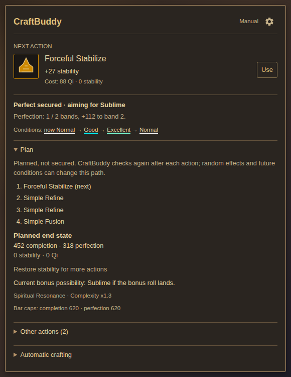
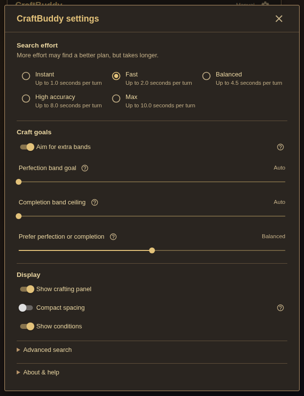

# CraftBuddy

A crafting assistant for **Ascend From Nine Mountains**. It reads your live craft, searches ahead and recommends the next technique, with optional auto-crafting.

CraftBuddy **6.9.0**, built for AFNM **0.7.19-ac29603**. [What's changed](CHANGELOG.md).


## Install

Subscribe on the [Steam Workshop](https://steamcommunity.com/sharedfiles/filedetails/?id=3661729323), or install manually:

1. Download `afnm-craftbuddy.zip` from [GitHub Releases](https://github.com/lemon07r/AFNM-CraftBuddy/releases).
2. Create a `mods` folder next to the game executable.
3. Copy the zip into it **without unzipping**, then launch the game.

## During a craft

The panel shows the recommended action, expected gains/costs, reasoning and ranked alternatives. It follows conditions, buffs, mastery, toxicity and all nine harmonies, and coexists with the game's native auto-use loadout rather than spending the same pill twice.

Outcome rows show the tier you are aiming for, each bar's bands and the bar holding the next tier back. There is no manual Finish button: crafts resolve when stability runs out or both bars reach their actual caps.



| Shortcut | Action |
| --- | --- |
| Ctrl+Shift+C | Toggle panel |
| Ctrl+Shift+M | Toggle compact mode |
| Ctrl+Shift+Y | Export a replay snapshot for a bug report |

## Settings

Open the panel's gear icon for the settings slide-over.



- **Fast** is the default preset. **Instant** uses the lowest budget; Balanced, High Accuracy and Max spend more search effort. “Instant” is not a zero-latency guarantee.
- Presets set depth, time, nodes and beam together. Raising one slider alone can waste work or reduce search quality; manual changes apply when you release the slider.
- **Goal Priority** biases completion or perfection without changing tier requirements.
- **Push Extra Bands** rewards progress beyond the secured tier. **Perfection Band Goal** asks for more perfection; **Completion Band Ceiling** stops rewarding completion beyond the chosen band, never below the tier requirement. Zero means Auto.
- Band widths grow by 1.3×: two bands are about 230% of the recipe target, not 200%. Sublime requires two bands on each bar.
- **Legacy** uses the established TS search. **Experimental** adds a Rust/WASM near-tie search prior; TS still owns the recommendation. Display and worker-thread options are also available.

Search stops at its time or node limit. Equal millisecond settings can reach different frontiers on different machines; reproducible comparisons use fixed node budgets with a nonbinding clock, not a promise that a preset always picks the same action.

## Reporting a problem

Press **Ctrl+Shift+Y during the craft** and attach the exported snapshot to a [GitHub issue](https://github.com/lemon07r/AFNM-CraftBuddy/issues). Include the action you expected and why; a replay is much more useful than a screenshot alone.

Previews use expected values, not predictions of hidden rolls. The panel is English-only. Some runtime effects and the survivability floor remain approximate; [known gaps](docs/MECHANICS_PARITY.md#known-gaps) lists them explicitly.

## Development

Prerequisites: Bun, Rust stable with `wasm32-unknown-unknown`, wasm-pack 0.14; Python 3 for the optional UI harness.

```bash
bun install
bun run typecheck
bun run build
```

[Development guide](docs/DEVELOPMENT.md): module map, tests, runtime integration and validation. [Optimizer design](docs/OPTIMIZER_DESIGN.md) explains recommendation behavior. Agents can start with `AGENTS.md` and load only the relevant local skill.

## Other mods

- [ElderGPT Spirit Ring](https://github.com/lemon07r/ElderGPT-Spirit-Ring) — an AI-powered contextual advisor overlay.
- [Lucky All Around](https://github.com/lemon07r/LuckyAllAround) — configurable pity-event luck weighting.
- [All my AFNM mods](https://steamcommunity.com/sharedfiles/filedetails/?id=3704747572).

Want to make a mod? [AFNM Agent Mod Template](https://github.com/lemon07r/AfnmAgentModTemplate) provides a starting scaffold.

## License

MIT.
